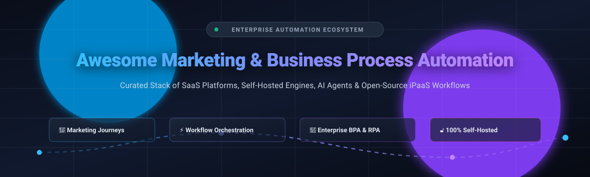

<div align="center">



# Awesome Marketing & Business Process Automation (BPA)

[](https://awesome.re)
[](https://github.com/ishandutta2007/Awesome-Marketing-Business-Process-Automation)
[](./LICENSE)
[](https://github.com/ishandutta2007/Awesome-Marketing-Business-Process-Automation/pulls)

**A curated index of leading SaaS tools, enterprise iPaaS, and production-ready open-source workflow automation software.**  
*Explore visual journey builders, API orchestrators, self-hosted marketing pipelines, and robotic process automation (RPA).*

[Sector Overview](#sector-overview--market-dynamics) • [SaaS Platforms](#saas-platforms) • [Open-Source Solutions](#open-source-github-projects) • [Stack Architecture](#stack-architecture--decision-guide) • [Contributing](#how-to-contribute)

</div>

---

## Sector Overview & Market Dynamics

The global **Marketing Automation** market is projected to reach **$8.1B–$8.4B by 2026** (CAGR ~12–15%), while the broader **Business Process Automation (BPA) & iPaaS** market stands at **$17B–$19B**. 

Market concentration follows a two-tier structural split:
- **Enterprise Core (Concentrated/Oligopolistic):** Enterprise suites and iPaaS backbones (e.g., Microsoft Power Automate, Adobe Marketo, HubSpot, Workato) command high institutional lock-in and multi-billion-dollar enterprise contracts through deeply coupled CRM, AI agents, and compliance ecosystems.
- **Mid-Market, SME & Open Source (Highly Fragmented):** The SME, niche marketing orchestration, and self-hosted workflow automation segments remain intensely fragmented. Point solutions (omnichannel SMS/email triggers, visual flow builders like Zapier/Make) and permissive open-source alternatives (n8n, Activepieces, Mautic) compete vigorously on data sovereignty, pricing transparency, and API flexibility.

---

## SaaS Platforms

Comparison of top-tier SaaS solutions for marketing automation, visual integration, and business workflow orchestration—sorted by company scale (valuation / market capitalization descending).

| Platform | Category / Primary Focus | Company Scale (Valuation / Market Cap) | Starting Price (Specific Tier) | Free Tier Limits / Free Trial |
| :--- | :--- | :--- | :--- | :--- |
| **[Microsoft Power Automate](https://powerautomate.microsoft.com/)** | Enterprise BPA, DPA & RPA Orchestration | **~$3.1 Trillion** (Market Cap - MSFT) | **$15/user/month** (Power Automate Premium per-user plan with standard cloud flows) | **90-Day Free Trial** (Includes premium connectors, attended RPA capabilities, and 5,000 AI Builder credits/month) |
| **[Adobe Marketo Engage](https://business.adobe.com/)** | Enterprise B2B Marketing Automation & Agentic AI | **~$220 Billion** (Market Cap - ADBE) | **~$1,250/month** ($15,000/year base Growth Tier for small contact databases) | **No Free Tier** (Interactive self-guided product tour & custom sales sandbox environment upon evaluation) |
| **[HubSpot Workflows](https://www.hubspot.com/)** | Inbound CRM, Lifecycle Marketing & RevOps Automation | **~$32 Billion** (Market Cap - HUBS) | **$15/seat/month** ($180/year billed annually for Starter Customer Platform) | **Free Forever CRM** (Basic email marketing, contact forms, and ad management; advanced multi-branch workflows require Professional tier / 14-day Pro trial) |
| **[Zapier](https://zapier.com/)** | No-Code Cloud Integration & Task Automation (7,000+ Apps) | **~$5.0 Billion** (Valuation) | **$19.99/month** ($239.88/year billed annually for Starter Tier with 750 tasks/mo and multi-step Zaps) | **Free Forever Plan** (100 tasks/month, 5 single-step Zaps, 15-minute update frequency) |
| **[Workato](https://www.workato.com/)** | Enterprise iPaaS, Data Orchestration & Low-Code Recipes | **~$5.7 Billion** (Valuation) | **~$833/month** (~$10,000/year base production workspace tier with core connector pack) | **30-Day Free Trial** (Full access to pre-built community recipes, API management, and connector builders) |
| **[Make](https://www.make.com/)** | Visual Scenario Workflow Automation (Formerly Integromat) | **~$1.6 Billion** (Valuation via parent Celonis) | **$9/month** ($108/year billed annually for Core Plan with 10,000 operations/month) | **Free Forever Plan** (1,000 operations/month, 2 active scenarios, 15-minute execution interval) |
| **[ActiveCampaign](https://www.activecampaign.com/)** | Customer Experience Automation (CXA) & Omnichannel Journeys | **~$3.0 Billion** (Valuation) | **$15/month** ($180/year billed annually for Starter Tier covering 1,000 contacts) | **14-Day Free Trial** (No credit card required; full access to automation builder, campaign testing, and CRM sync) |
| **[Tray.io](https://tray.ai/)** | Low-Code Enterprise Automation & AI Workflow Builder | **~$650 Million** (Valuation) | **~$600/month** (~$7,200–$18,000/year baseline mid-market Team/Pro contract; developer runtimes from $50/mo) | **14-Day Free Trial** (Includes visual builder canvas, standard API connectors, and execution logging) |
| **[Customer.io](https://customer.io/)** | Behavioral Event-Driven Messaging & Customer Journey Funnels | **~$350 Million** (Valuation) | **$100/month** (Essentials Plan covering up to 5,000 profiles and 1,000,000 emails/month) | **14-Day Free Trial** (Complete access to event triggers, behavioral segments, and omnichannel messaging canvas) |
| **[Omnisend](https://www.omnisend.com/)** | Ecommerce Marketing Automation (Email, SMS & Push) | **~$150 Million** (Valuation) | **$16/month** (Standard Plan covering up to 500 contacts and 6,000 emails/month) | **Free Forever Plan** (Up to 250 contacts, 500 emails/month, 60 SMS credits, and pre-built ecommerce automations) |

---

## Open-Source GitHub Projects

Self-hosted, transparent, and developer-centric automation platforms. Ranked by GitHub Stargazers (descending) to highlight community adoption and engineering maturity.

| Repository | GitHub Stars | License | Primary Architectural Focus | Key Features & Capabilities |
| :--- | :---: | :---: | :--- | :--- |
| **[n8n](https://github.com/n8n-io/n8n)** | [](https://github.com/n8n-io/n8n/stargazers) | Sustainable Use License | Node-Based Workflow Orchestration & AI Agents | 350+ integrations, visual drag-and-drop canvas, LangChain/AI agent node execution, self-hosted data isolation. |
| **[NocoDB](https://github.com/nocodb/nocodb)** | [](https://github.com/nocodb/nocodb/stargazers) | AGPL-3.0 | Smart Database, Airtable Alternative & Event Triggers | Turns relational databases (PostgreSQL, MySQL, SQLite) into smart collaborative spreadsheets with webhook automations. |
| **[Twenty](https://github.com/twentyhq/twenty)** | [](https://github.com/twentyhq/twenty/stargazers) | AGPL-3.0 | Modern CRM & Business Process Automation Engine | Open-source alternative to Salesforce; custom objects, workflow triggers, GraphQL/REST APIs, self-hostable Docker stack. |
| **[Huginn](https://github.com/huginn/huginn)** | [](https://github.com/huginn/huginn/stargazers) | MIT | Autonomous Web Agents & Event Scrapers | Self-hosted "Yahoo Pipes / IFTTT" builder; executes tasks, monitors online events, scrapes web pages, and acts on triggers. |
| **[ERPNext](https://github.com/frappe/erpnext)** | [](https://github.com/frappe/erpnext/stargazers) | GPL-3.0 | Full-Stack Enterprise BPA & Operations ERP | End-to-end business process orchestration covering sales pipelines, marketing campaigns, billing, inventory, and payroll. |
| **[Novu](https://github.com/novuhq/novu)** | [](https://github.com/novuhq/novu/stargazers) | MIT | Unified Multi-Channel Notification Workflow Engine | Developer-first notification orchestration across email, SMS, push, chat, and in-app feeds with visual digest and delay logic. |
| **[Directus](https://github.com/directus/directus)** | [](https://github.com/directus/directus/stargazers) | BSL 1.1 | Backend-as-a-Service & Event-Driven Flows | Dynamic data engine featuring visual Flows (triggers, condition blocks, API webhooks, transformation steps, and cron jobs). |
| **[Activepieces](https://github.com/activepieces/activepieces)** | [](https://github.com/activepieces/activepieces/stargazers) | MIT | Open No-Code Workflow Automation & AI Copilot | 500+ pre-built integrations, visual branch logic, TypeScript execution sandbox, human-in-the-loop approvals, MCP support. |
| **[Trigger.dev](https://github.com/triggerdotdev/trigger.dev)** | [](https://github.com/triggerdotdev/trigger.dev/stargazers) | Apache-2.0 | Code-First Background Jobs & Complex Long-Running Flows | Reliable serverless workflow engine with zero timeouts, scheduling, real-time logging, and automatic retries. |
| **[Automatisch](https://github.com/automatisch/automatisch)** | [](https://github.com/automatisch/automatisch/stargazers) | AGPL-3.0 | Privacy-Centric No-Code Business Automation | GDPR-compliant, privacy-first alternative to Zapier; no cloud telemetry, self-hosted webhooks, and SaaS connectors. |
| **[Mautic](https://github.com/mautic/mautic)** | [](https://github.com/mautic/mautic/stargazers) | GPL-3.0 | 100% Community Open-Source Marketing Automation | Lead scoring, multi-channel customer profiles, drag-and-drop campaign canvas, email A/B testing, and GDPR compliance. |

---

## Stack Architecture & Decision Guide

Choosing between SaaS platforms and self-hosted open-source software depends on compliance posture, engineering bandwidth, and process complexity:

```
                                ┌───────────────────────────────┐
                                │ Marketing & Process Automation│
                                └──────────────┬────────────────┘
                                               │
                    ┌──────────────────────────┴──────────────────────────┐
                    ▼                                                     ▼
        ┌───────────────────────┐                             ┌───────────────────────┐
        │     SaaS Solutions    │                             │  Open-Source & Local  │
        └───────────┬───────────┘                             └───────────┬───────────┘
                    │                                                     │
         ┌──────────┴──────────┐                               ┌──────────┴──────────┐
         ▼                     ▼                               ▼                     ▼
┌─────────────────┐   ┌─────────────────┐             ┌─────────────────┐   ┌─────────────────┐
│ Integrated CRM  │   │  Cloud iPaaS    │             │Pure Mktg Engine │   │Workflow Engine  │
│ (HubSpot,       │   │  (Zapier, Make, │             │ (Mautic, Twenty)│   │(n8n, Active-    │
│  ActiveCampaign)│   │   Workato)      │             │                 │   │ pieces, Trigger)│
└─────────────────┘   └─────────────────┘             └─────────────────┘   └─────────────────┘
```

- **Choose SaaS (HubSpot, Zapier, Workato)** when your priority is immediate time-to-value, managed uptime, enterprise SOC2 compliance, and out-of-the-box native integrations with non-technical team collaboration.
- **Choose Open-Source (Mautic, n8n, Activepieces)** when data privacy, GDPR data residency, air-gapped security, customized code execution, and freedom from high recurring volume fees are paramount.

---

## How to Contribute

Contributions, tool suggestions, and pull requests are warmly welcomed!

1. **Fork** this repository.
2. Add your suggested tool or framework to `README.md` maintaining table formatting and objective descriptions.
3. If submitting an open-source project, verify the GitHub link and star badge syntax.
4. Open a **Pull Request** with a brief summary of the project's unique strengths.

---

## Disclaimer

This compilation is maintained by the community for educational and evaluation purposes. All registered product names, logos, and trademarks belong to their respective corporate owners. Pricing and limits are subject to change over time; please verify real-time terms directly on the official vendor websites.
